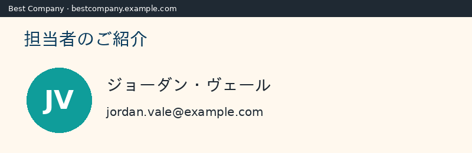
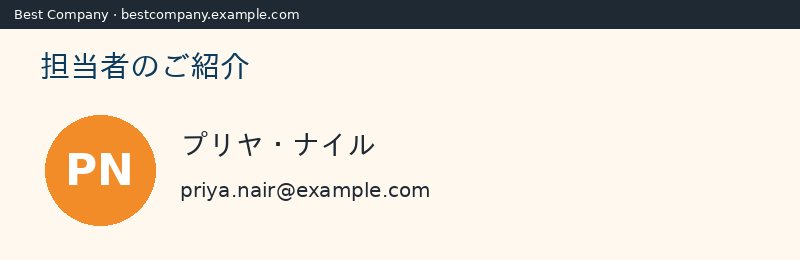

# Before and after

Three of the replaced images, one per locale. Left: the original, kept in `backups/originals/`. Right: the replacement now on the site. Only the person changes; the layout, background and name pattern stay the same.

Synthetic data only. Every name and `example.com` address is fictional.

| Locale | Before (outdated persona) | After (approved persona) |
|---|---|---|
| en-US |  `backups/originals/assets/en-US/hero-05.png` |  `site/assets/en-US/hero-05-v2.png` |
| ja-JP |  `backups/originals/assets/ja-JP/hero-01.png` |  `site/assets/ja-JP/hero-01-v2.png` |
| ar-SA |  `backups/originals/assets/ar-SA/hero-10.png` |  `site/assets/ar-SA/hero-10-v2.png` |
